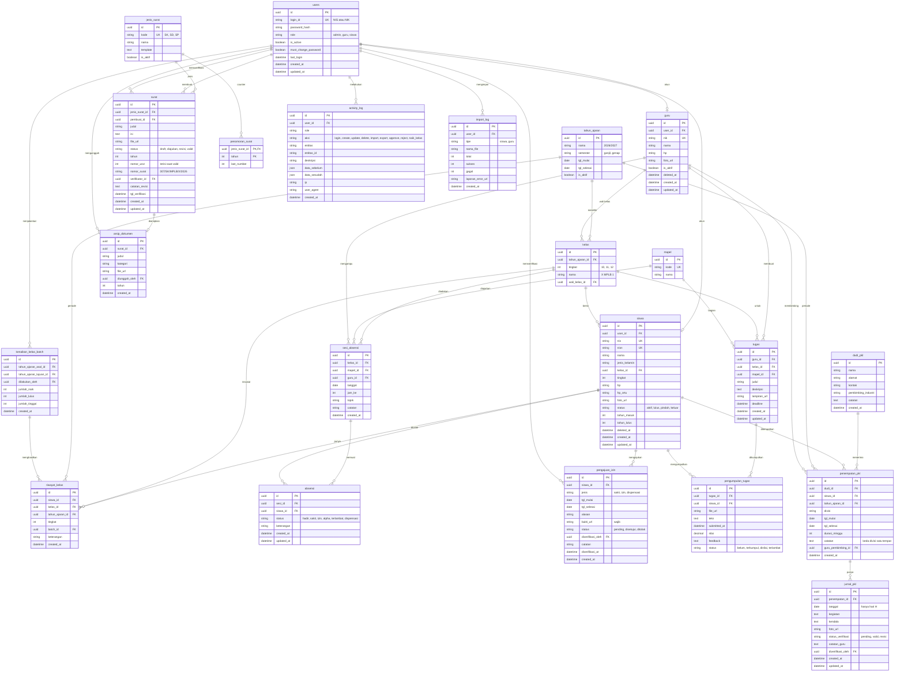

# ERD — Sistem Digitalisasi Pembelajaran MPLB

Database: **PostgreSQL**. ORM: **Prisma**. Penamaan tabel dan kolom: `snake_case`, bahasa Indonesia untuk domain sekolah.

> Diagram memakai sintaks Mermaid `erDiagram`. Notasi: `||--o{` berarti satu ke banyak, `||--o|` berarti satu ke nol-atau-satu.

---

## 1. Diagram Relasi



---

## 2. Constraint dan Indeks

### Unique
| Tabel | Constraint |
|---|---|
| users | `login_id` |
| siswa | `nis`, `nisn`, `user_id` |
| guru | `nik`, `user_id` |
| mapel | `kode` |
| jenis_surat | `kode` |
| absensi | (`sesi_id`, `siswa_id`) |
| pengumpulan_tugas | (`tugas_id`, `siswa_id`) |
| jurnal_pkl | (`penempatan_id`, `tanggal`) |
| penempatan_pkl | (`siswa_id`, `tahun_ajaran_id`) |
| surat | (`jenis_surat_id`, `tahun`, `nomor_urut`), parsial hanya bila `nomor_urut` tidak null |
| penomoran_surat | PK gabungan (`jenis_surat_id`, `tahun`) |

### Indeks
`siswa(nis)`, `siswa(kelas_id, status)`, `absensi(siswa_id, sesi_id)`, `sesi_absensi(tanggal)`, `sesi_absensi(kelas_id, tanggal)`, `pengajuan_izin(status)`, `surat(status)`, `jurnal_pkl(tanggal)`, `activity_log(created_at, user_id)`.

### Check constraint
- `users.role` ∈ (`admin`, `guru`, `siswa`). Guest tidak punya baris di `users`.
- `siswa.status` ∈ (`aktif`, `lulus`, `pindah`, `keluar`).
- `absensi.status` ∈ (`hadir`, `sakit`, `izin`, `alpha`, `terlambat`, `dispensasi`).
- `pengajuan_izin.bukti_url` NOT NULL.
- `surat.nomor_surat` dan `nomor_urut` wajib terisi bila `status = 'valid'`.
- `jurnal_pkl.tanggal` diperiksa di server agar sama dengan hari ini (Asia/Jakarta).

---

## 3. Aturan Data Penting

1. **Soft delete** pada `siswa` dan `guru` lewat `deleted_at`. Semua query default menyaring `deleted_at IS NULL`.
2. **Penomoran surat** dilakukan dalam satu transaksi:
   ```sql
   -- di dalam BEGIN ... COMMIT
   INSERT INTO penomoran_surat (jenis_surat_id, tahun, last_number)
   VALUES ($1, $2, 1)
   ON CONFLICT (jenis_surat_id, tahun)
   DO UPDATE SET last_number = penomoran_surat.last_number + 1
   RETURNING last_number;
   ```
   Hasilnya disimpan ke `surat.nomor_urut` bersama perubahan status menjadi `valid`.
3. **Naik kelas** dalam satu transaksi: update `siswa.kelas_id` dan `siswa.tingkat` (atau `status='lulus'` untuk tingkat 12), insert `riwayat_kelas`, insert `kenaikan_kelas_batch`, insert `activity_log`.
4. **Izin disetujui** menulis (upsert) baris `absensi` untuk setiap tanggal dalam rentang izin pada sesi yang ada, sesuai jenis izin.
5. **Rekap bulanan dan semester tidak disimpan**. Dihitung dari `absensi` join `sesi_absensi` dengan `GROUP BY siswa_id, status` pada rentang tanggal.
6. **Kepala program** memiliki satu baris `users` (role `admin`) dan satu baris `guru` yang menunjuk ke `user_id` yang sama.
7. **activity_log** hanya di-insert. Tidak ada update atau delete lewat aplikasi.
8. Foto dan berkas **tidak disimpan di database**, hanya URL dari storage.

---

## 4. Fase 2 (belum dirancang)

`inventaris_barang`, `peminjaman_barang`, `perjalanan_dinas`, `petty_cash_transaksi`. Dirancang setelah kebutuhan dikonfirmasi pihak sekolah.
